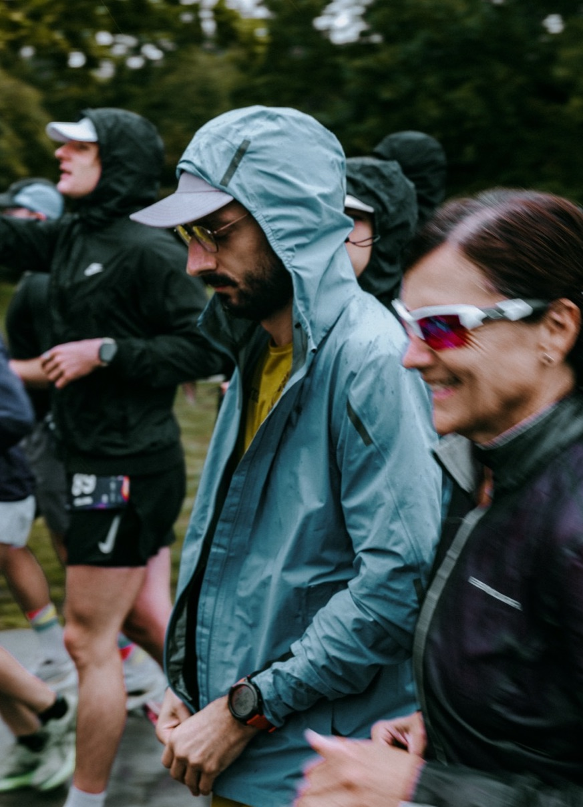
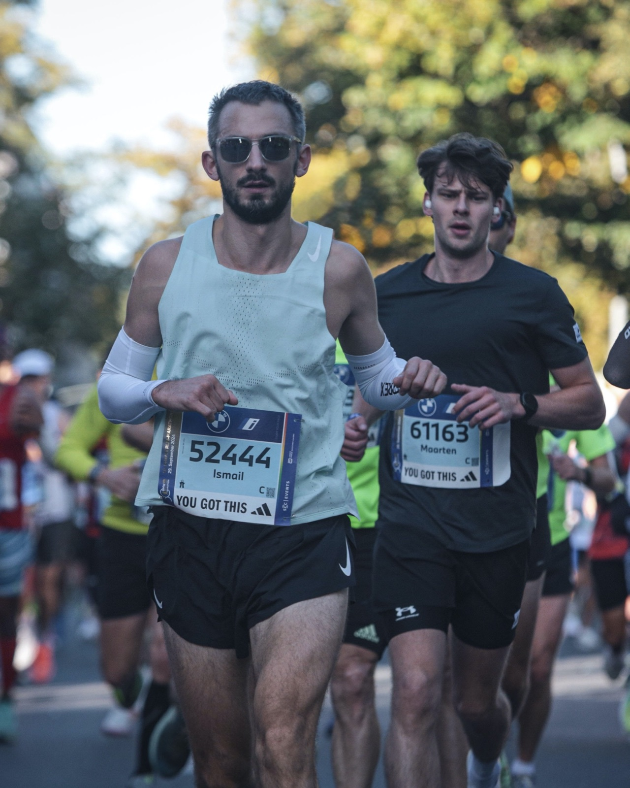
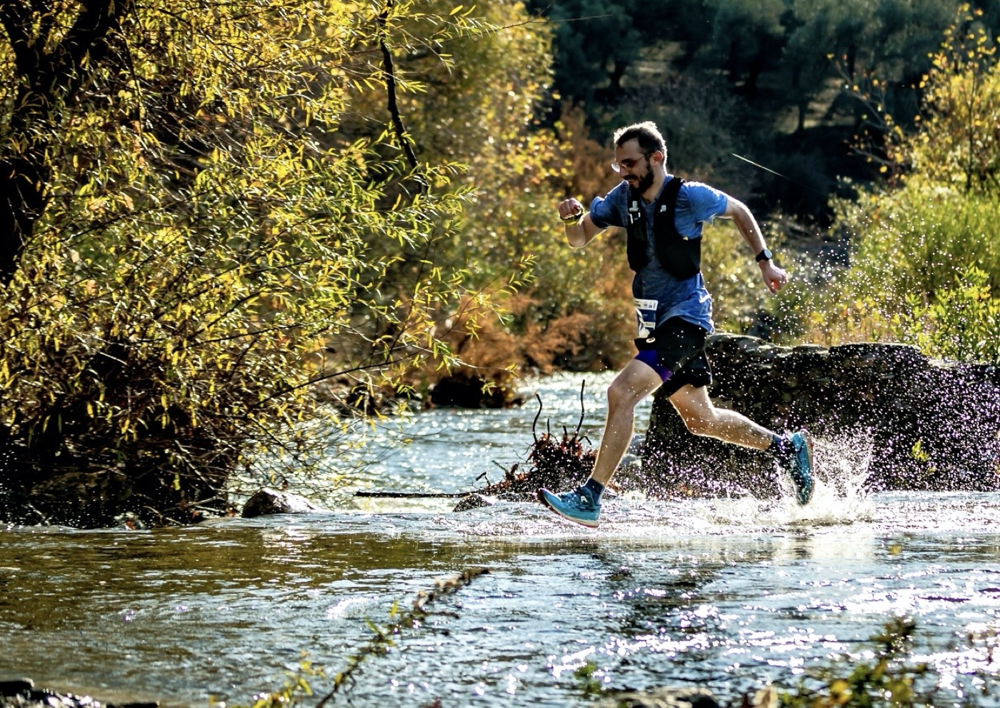
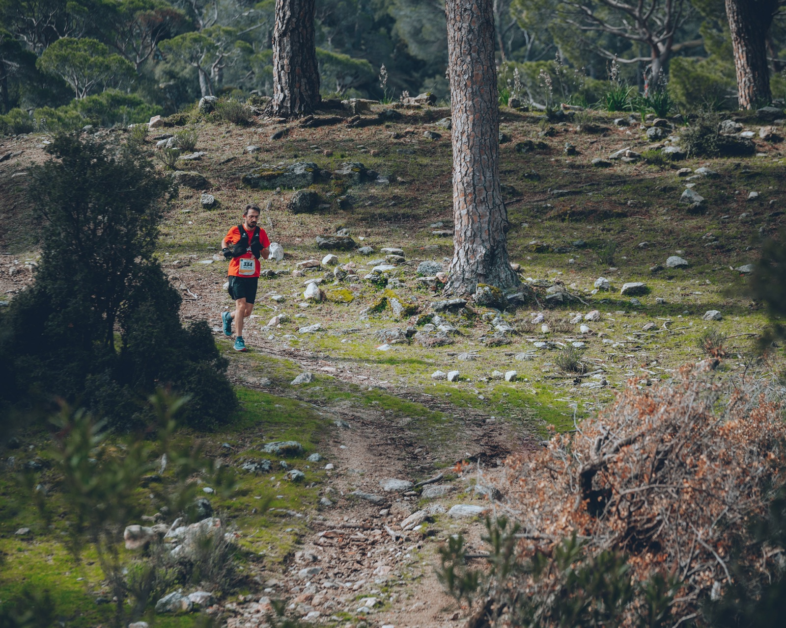

I have been in love with nature since I was a kid. I spent my summer holidays in my hometown, Rize, among green mountains and tea fields in one of the rainiest corners of Turkey. That love led me to study biology and then a master's in ecology. Somewhere along the way, it narrowed down to one question: why, where and when do wildfires burn?

That question took me to ETH Zurich for my PhD and then to the Technical University of Munich as a postdoctoral fellow.

"How does that connect to data science?" you might ask.The thing about wildfires is that they feel common but statistically they are rare: millions of places and days without fire for every one that burns. That makes modeling them, as Rocky would say, bad bad bad. Every project turned into the same puzzle: huge datasets, very few events, and plenty of ways to fool yourself. Solving it kept pushing me deeper into data science than I ever planned and at some point I noticed that the fires had become the excuse. What I actually loved was the data: digging into it, finding the pattern, solving the puzzle.

So I am following that. I am moving into applied data science, where that kind of problem-solving is not a side effect of the job but the job itself.

Outside work, I run a lot. I am still figuring out which distance I love most. So far, my sample includes an 18:06 5K, a 2:59 marathon and 176 km at a Backyard Ultra, where you run a 6.7 km loop every hour, on the hour, until you can't anymore (never heard of a Backyard Ultra? Drop me a message. I can talk about it for a very, very long time). Sample size is still small, so the experiment continues.

When I am not running, I am bouldering, collecting Rubik's cubes or turning my flat into a tropical greenhouse, one rare aroid at a time. 

::: {.gallery layout-ncol="2"}

{group="about"}

{group="about"}

{group="about"}

{group="about"}

:::